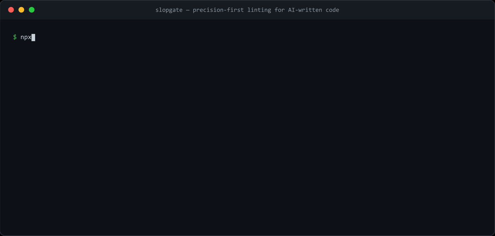

# slopgate

**The slop gate for AI-written code.**

AI writes code that *looks* right. `slopgate` finds the parts that only look right: imports of packages that do not exist, tests that cannot fail, functions that are stubs, errors that vanish without a trace.



[](https://www.npmjs.com/package/@voidh4x0r/slopgate)
[](https://github.com/VoidH4x0r/slopgate/actions/workflows/ci.yml)
[](https://github.com/VoidH4x0r/slopgate/blob/main/LICENSE)
[](https://github.com/VoidH4x0r/slopgate/blob/main/package.json)

```console
$ npx @voidh4x0r/slopgate .

slopgate 0.1.18  ·  4 files  ·  39ms

app.py
       4:1  error   high   py/phantom-import       `helper` is imported but not declared in any manifest and not present in this repository
            │ from helper import format_value
            · manifests checked: pyproject.toml
            ↳ Add it to your manifest, remove the import, or wrap it in try/except ImportError if it is optional.

       7:1  warning high   py/stub-body            function `get_user` is a stub (body is `pass`)
            │ def get_user(user_id):
            · body: pass
            ↳ Implement it, or raise NotImplementedError with a message so callers fail loudly instead of silently returning None.

      14:5  warning high   py/swallowed-exception  `except` swallows the error silently
            │ except Exception:
            ↳ Log it, re-raise it, or narrow the exception type and add a comment explaining why it is safe to ignore.

      22:5  error   high   py/unreachable          code after `return` is unreachable
            │ print("dead code after return")
            ↳ Delete the unreachable code, or move it before the exit if it was meant to run.

tests/test_users.py
       4:1  warning high   py/noop-test            test `test_get_user` makes no assertions
            │ def test_get_user():
            ↳ Every test should be able to fail. Add an assertion that depends on the behaviour under test.

  13 findings in 3 files  ·  4 files scanned in 39ms
  4 error · 9 warning · 0 info   (13 high · 0 medium · 0 low confidence)
  hidden: 1 below confidence threshold
```

No API keys. No telemetry. No network calls at runtime. One command, works offline, exits non-zero in CI.

## What it catches

Models are good at producing code that compiles, imports cleanly in the editor where the package happened to be installed, and passes tests that assert nothing. These failures are boring, repetitive, and invisible to a green CI run:

| What the model wrote | What it costs you |
| --- | --- |
| `import requests_v2` — the package does not exist | `ModuleNotFoundError` in CI, or a malicious package if that name is ever registered |
| `def test_create(): service.create()` — no assertion | A green test with zero coverage |
| `def sync(self): pass` — real signature, empty body | Callers get `None` and the failure surfaces three layers downstream |
| `except Exception: pass` | The error disappears; the incident does not |
| `return user` followed by 12 lines of code | Dead code that nobody notices until it rots |

`slopgate` is a **precision-first** linter for exactly this class of defect, for Python and TypeScript/JavaScript.

It is built for the people who review AI-generated pull requests: the reviewer who cannot read every line, the maintainer who needs CI to say "this is not finished", and the coding agent that should check itself before declaring done.

## Does it actually catch anything?

Measured on **1,115,177 lines** of real code — the CPython standard library (an adversarial corpus full of test helpers and intentional no-ops) plus nine popular JavaScript packages:

| Metric | Result |
| --- | --- |
| High-confidence findings | **29** (0.03 per 1,000 lines), in 17 of 1,845 CPython files |
| Labeled precision of high-confidence findings | **96.6%** (28/29 manually reviewed) |
| Recall on 14 seeded defects | **14/14** |
| High-confidence findings on 601 JavaScript files (`eslint`, `express`, `execa`, `semver`, `chalk`, `commander`, `debug`, `yargs`, `glob`) | **0** (these packages contain no Tape/TAP suites or bundled output — see the [coverage note](docs/benchmark.md#what-the-javascript-half-does-not-cover)) |

The labels, the corpus definition and the harness are in [`benchmark/`](https://github.com/VoidH4x0r/slopgate/tree/main/benchmark) and [`docs/benchmark.md`](https://github.com/VoidH4x0r/slopgate/blob/main/docs/benchmark.md); `node scripts/benchmark.mjs` reproduces the numbers. We publish the false positives instead of hiding them.

---

## Why another linter

`ruff`, `eslint` and friends check *style and syntax*. They cannot tell you that a package is hallucinated, because that requires reading your manifests. They cannot tell you that a test is theatre, because that requires understanding what an assertion is.

`slopgate` complements them. It only ships rules that need **AST + project context** (manifests, imports, test structure), and it optimises for the opposite of most linters: **almost no false positives**, even if that means fewer rules.

|  | slopgate | style linters (ruff / eslint) | AI-slop regex scanners |
| --- | --- | --- | --- |
| Real AST (tree-sitter) | ✅ | ✅ | often regex |
| Knows your dependency manifests | ✅ | ❌ | partial |
| Confidence tiers, high by default | ✅ | ❌ | ❌ |
| `--baseline` so you can adopt it on a legacy repo | ✅ | ⚠️ per-file only | ❌ |
| `--diff` so CI only fails on new code | ✅ | ❌ | ❌ |
| MCP server so agents can self-check | ✅ | ❌ | ❌ |
| SARIF for GitHub code scanning | ✅ | ✅ | rare |
| Zero configuration to start | ✅ | ✅ | ⚠️ |

## Install

```bash
npx @voidh4x0r/slopgate .                  # try it without installing
npm install -D @voidh4x0r/slopgate         # or pin it in your project
npx @voidh4x0r/slopgate init               # write .slopgate.json + a GitHub Action
```

Requires Node 20+. Python and TypeScript grammars are bundled — no Python or `tsc` needed at scan time.

The npm scope is `@voidh4x0r` because the unscoped name `slopgate` was rejected as too similar to the existing `slop-gate` package; the command is still `slopgate`.

## Usage

```bash
slopgate [path] [options]

  --format pretty|json|sarif|github output format                  (default: pretty)
  --confidence high|medium|low    minimum confidence to report       (default: high)
  --fail-on high|medium|low|none  minimum confidence that fails CI   (default: high)
                                   (a lower value also lowers what is displayed)
  --baseline [path]               ignore findings recorded in a file (default: .slopgate-baseline.json at the repo root)
  --write-baseline [path]         record current findings, then exit 0
  --diff [ref]                    only report findings on changed lines (default: HEAD)
  --include/--exclude <glob>      adjust the file set
  --rule <id>                     run a single rule
  --no-color --quiet --verbose
  --force                         overwrite files written by `init`
  -h, --help / -V, --version
```

### Configuration

`slopgate` reads `.slopgate.json` (or `slopgate.config.json`) by walking up from the scan target to the git repository root and using the **nearest** config. A package config such as `packages/app/.slopgate.json` overrides the root config; `src` with no config falls back to the root. Every key is optional:

```json
{
  "include": ["src/**", "tests/**"],
  "exclude": ["vendor/**", "migrations/**"],
  "ignoreModules": ["my_private_pkg"],
  "rules": {
    "ts/swallowed-exception": "off",
    "py/stub-body": "warning"
  },
  "confidence": "high",
  "failOn": "high"
}
```

- `include` / `exclude` — globs relative to the **config file's directory** (or the project root when no config file exists). **A config `include` replaces the default pattern set** (the ten Python/TS/JS globs); list every extension you still want. The CLI `--include` **appends** to the effective set, so `--include "src/**"` keeps the defaults.
- `ignoreModules` — top-level modules to always treat as declared (dynamic imports, private packages).
- `rules` — `"off"` or an explicit severity (`"error"`, `"warning"`, `"info"`). Severity changes display and annotation level only; **CI failure is controlled by confidence and `--fail-on`**. A rule set to `"info"` stays visible and still fails when its confidence meets `--fail-on`; use `"off"` or a baseline to exempt it.
- `confidence` / `failOn` — same meaning as the CLI flags; CLI flags win.

For example, `{"include": ["src/**"]}` scans only files under `src/`; it does **not** keep the default Python/TS/JS coverage. Add the patterns you need, or use the CLI flag to append one pattern to the defaults.

In a monorepo, dependencies are resolved per file from the nearest manifest **for that language** (a nested `package.json` does not hide a parent Python `pyproject.toml`). The `.slopgate.json` closest to the scan target applies to the whole run; scan an individual package when you need that package's config to govern its own files.

The default `.slopgate-baseline.json` also lives at the repository root. `--baseline` and `--write-baseline` paths resolve there, so scanning `src` and then the repository root share one baseline. Baseline fingerprints use the same repository-relative paths as reports, so one root baseline works for `slopgate .`, `slopgate src`, and `slopgate path/to/file.py`.

Reported paths (including SARIF and GitHub annotations) are relative to the nearest git repository root. If the target is outside a git repository, paths stay relative to the scan target; manifest lookup still walks up to the current working directory when it contains the target, while config lookup stops at the nearest project boundary.

`slopgate init` writes a minimal config at the requested directory and a GitHub Actions workflow at the repository root; the workflow targets that directory. Run it at the repository root for a repo-wide config.

### Adopting it on an existing repository

This is the part most linters get wrong. A 200k-line repo has 900 findings on day one, so nobody turns it on.

```bash
# 1. Record what is already there. Nothing fails, nothing is "fixed" blindly.
npx @voidh4x0r/slopgate . --write-baseline

# 2. Commit the baseline. From now on only NEW findings fail CI.
npx @voidh4x0r/slopgate . --fail-on high

# 3. Or gate only the lines a pull request touches:
npx @voidh4x0r/slopgate . --diff origin/main --fail-on high
```

### Auditing AI-written code

The defaults are tuned for human-maintained code: an interface stub in a library is often deliberate, so class-method stubs and documented `pass` bodies are `medium`. AI-generated code has the opposite prior — an unimplemented method is usually unfinished — so audit it with the medium threshold:

```bash
# 1. Absorb the existing medium-confidence debt once.
npx @voidh4x0r/slopgate . --confidence medium --fail-on medium --write-baseline

# 2. Gate NEW implementation stubs and test theatre at medium.
npx @voidh4x0r/slopgate . --confidence medium --fail-on medium
```

`slopgate init --strict` writes this policy into `.slopgate.json` and the generated GitHub Actions workflow. Keep the default `init` for human-maintained repositories.

**Scope of medium:** the medium threshold covers stubs whose entire body is `pass`, `...` or `throw new Error("not implemented")`. A bare `return None` is reported at `low`; `return []`, `{}`, `""`, `False` and empty classes are **not reported**, because they are indistinguishable from legitimate default return values. Do not expect strict mode to catch those placeholder returns.

### Use it from a coding agent (MCP)

`slopgate` ships a Model Context Protocol server over stdio, so Claude Code, Codex and other MCP clients can check their own diff **before** saying "done".

```json
{
  "mcpServers": {
    "slopgate": { "command": "npx", "args": ["-y", "@voidh4x0r/slopgate", "mcp"] }
  }
}
```

| Tool | What the agent gets |
| --- | --- |
| `scan_diff` | findings on lines changed since a git ref (default `HEAD`) |
| `scan_path` | findings in a file or directory |
| `list_rules` | the rule table, so the agent knows what is checked |

Reports are compact text: `file:line:col severity confidence rule-id message`, evidence included, capped at 50 findings per call. Paths are relative to the MCP server root, and config is resolved per requested path with the same nearest-config rule as the CLI. Point the MCP server at the repository root; use `scan_path` to select subdirectories. The server reads `.slopgate.json` and `.slopgate-baseline.json` like the CLI does, so an agent never re-reports debt you already accepted. It runs locally, makes no network calls, and writes nothing to disk.

Full details: [docs/mcp.md](https://github.com/VoidH4x0r/slopgate/blob/main/docs/mcp.md).

## In CI

`.github/workflows/slopgate.yml` (written by `slopgate init`):

```yaml
name: slopgate
on: [push, pull_request]
permissions:
  contents: read
jobs:
  slopgate:
    runs-on: ubuntu-latest
    steps:
      - uses: actions/checkout@v4
      - uses: actions/setup-node@v4
        with: { node-version: 22 }
      - run: npx --yes @voidh4x0r/slopgate@0.1.18 . --fail-on high
```

For GitHub code scanning, use `--format sarif` and upload with `github/codeql-action/upload-sarif`.

For inline pull-request annotations **without** code scanning, use `--format github`, which emits [workflow commands](https://docs.github.com/en/actions/using-workflows/workflow-commands-for-github-actions):

```yaml
      - run: npx --yes @voidh4x0r/slopgate@0.1.18 . --format github --fail-on high
```

Each finding becomes an `error` / `warning` / `notice` annotation on the exact line, followed by a summary notice.

Exit codes: `0` no findings at or above `--fail-on`, `1` findings at or above the threshold, `2` usage or configuration error (missing path, unknown rule id, invalid config, git failure, or zero files matched).

### Suppressing a finding

```python
# slopgate-ignore-next-line py/stub-body
def todo(self):
    pass
```

```ts
// slopgate-ignore-line ts/swallowed-exception
try { ... } catch {}
```

`slopgate-disable-file` at the top of a file disables it entirely. Directives only count inside real comments — a mention in a string or a doc is not a suppression.

## Rules

14 rules across Python and TypeScript/JavaScript. Full reference with examples: [docs/rules.md](https://github.com/VoidH4x0r/slopgate/blob/main/docs/rules.md).

| Rule | Catches |
| --- | --- |
| `py/phantom-import` · `ts/phantom-import` | import that no manifest declares and, for TS, that is not even installed |
| `py/noop-test` · `ts/noop-test` | `test_*` / `test()` / `it()` bodies with no assertion |
| `py/tautological-assert` · `ts/tautological-assert` | `assert True`, `expect(true).toBe(true)`, `x == x` |
| `py/stub-body` · `ts/stub-function` | function declarations and class methods whose body is only `pass`, `...`, `{}`, or `throw new Error("not implemented")` (empty arrow callbacks are not reported unless they throw) |
| `py/swallowed-exception` · `ts/swallowed-exception` | `except: pass`, `catch {}` (JS empty catch is medium by design) |
| `py/dead-branch` · `ts/dead-branch` | `if False:` / `if (false)`, and their always-true twins |
| `py/unreachable` · `ts/unreachable` | statements after `return` / `raise` / `throw` / `continue` |

## Precision is the product

Every finding carries a **confidence** derived from evidence, not vibes:

- **high** — a fact you can verify by reading the line: the package is not in the manifest, the test has no assertion, the body is empty. This is what runs by default and what fails CI.
- **medium** — a fact plus a reason it might be intentional: an empty `catch` (idiomatic in JavaScript), an exception swallowed inside a cleanup function, a test method that may delegate its assertions to a helper, any finding in a file that did not parse cleanly.
- **low** — reserved for heuristics we are not confident about yet.

`--confidence medium` shows the middle tier; `--confidence low` shows everything the rules can see. `--verbose` prints the resolved config, include count, baseline and diff-filter details; finding evidence is printed for every finding regardless of this flag.

We would rather miss a finding than teach you to ignore the tool. That is also why rules skip test files where the scaffolding is intentional, and why a file with syntax errors can never produce a high-confidence finding.

## Performance

`slopgate` parses with tree-sitter compiled to WebAssembly and reuses one parser per language. Scanning never spawns a subprocess. `--diff` and the MCP `scan_diff` tool invoke `git`, so those two paths need git on `PATH` and a sandbox that permits child processes:

- 20 files / ~3k lines: **~125 ms** end to end (Windows laptop, cold start)
- 1,845 files / 991,705 lines (CPython standard library): **~11 s** in the benchmark run
- 3 grammar files load once in **~35 ms**
- Python: ~12 ms per 35 KB file

## Roadmap

- [x] v0.1 — 14 rules, Python + TS/JS, baseline, diff mode, SARIF, GitHub annotations, MCP server, suppression
- [ ] v0.2 — duplicate-block detection, Go and Rust grammars, `--fix` for the safe subset
- [ ] v0.3 — published false-positive benchmark across popular repositories, VS Code diagnostics

## Known limitations

- `.gitignore` is not read. Generated trees are skipped only through the built-in ignore list and your own `exclude` patterns.
- Symbolic links are skipped, but they are **not** counted in `stats.skipped`. Files larger than 1 MB, empty files, excluded files and unreadable files are counted.
- Bundled/minified files are only skipped when named `*.min.js` / `*.min.mjs`; exclude hashed chunk directories with your own `exclude` patterns.
- Modules that only exist on a non-CPython host (Jython's `java.*`, Emscripten's `js` / `pyodide`) are reported unless you add them to `ignoreModules`.
- A path whose name matches a subcommand (`rules/`, `init/`, `scan/`) is parsed as the subcommand; write `./rules` to scan that directory.

## When **not** to use it

- You want style, formatting or type checking — use `ruff` / `eslint` / `tsc`.
- You need whole-program data-flow analysis — that is `semgrep` / CodeQL territory.
- Your code is not generated or reviewed quickly; the rules still apply, but the value is lower.

## Contributing

Issues and pull requests are welcome. Start with [CONTRIBUTING.md](https://github.com/VoidH4x0r/slopgate/blob/main/CONTRIBUTING.md); adding a rule is a ~80 line change plus tests.

```bash
git clone https://github.com/VoidH4x0r/slopgate
cd slopgate
npm install
npm test            # 304 tests; the tests themselves make no network or child-process calls
npm run typecheck
npm run verify      # all release gates in one command
```

## License

MIT
