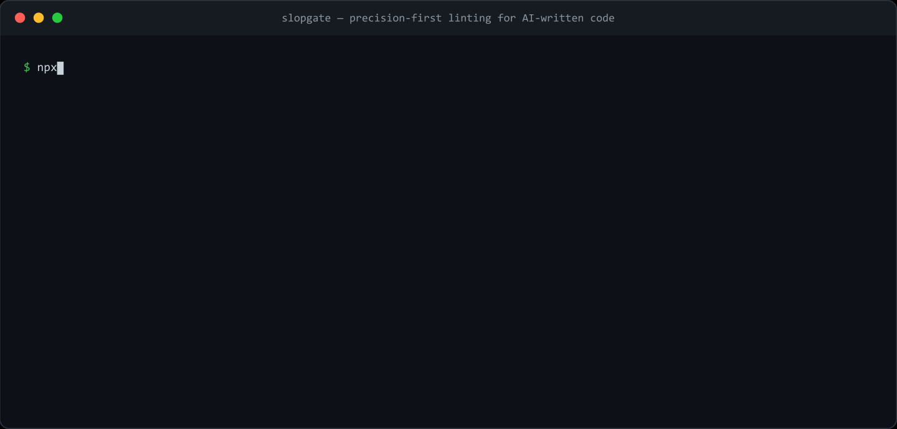
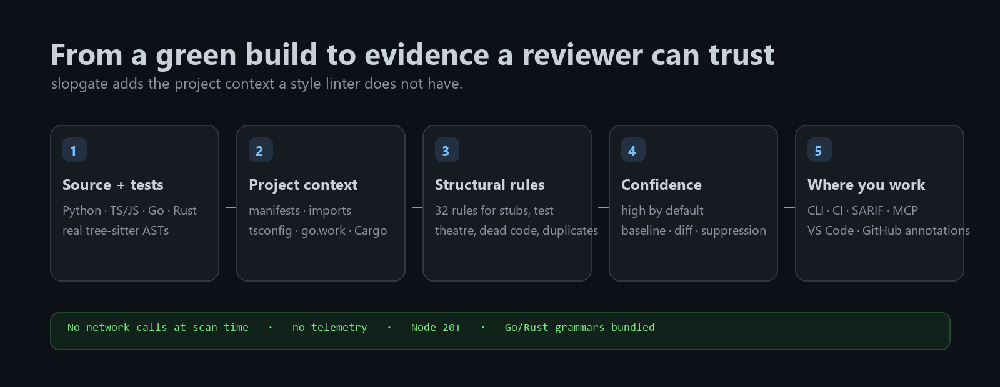

# slopgate 中文指南

[English](../../README.md) · [中文](README.md)

**给 AI 生成代码装一道“防敷衍”闸门。**

AI 写的代码往往“看起来是对的”：import 了一个根本不存在的包，测试跑过了却没有断言，函数有完整签名但函数体是 `pass`，异常被 `except: pass` 吞掉。`slopgate` 只报告这些能由 AST 和项目上下文证明的“结构性敷衍”，默认只显示 `high` confidence。

它不替代 `ruff`、`eslint`、`tsc`、`mypy` 或测试框架。它补的是另一类问题：**代码能编译、能导入、CI 是绿的，但功能没有真正完成。**



上图来自真实的 `fixtures/demo` 扫描：4 个文件、12 条 high confidence finding；终端里只展示了其中一部分，完整结果还包括 dead branch 和 tautological assert。

## 为什么需要它

传统 linter 检查风格、语法和类型。它们不知道：

- `import requests_v2` 是否真的存在于依赖清单；
- 一个 `test_*` 函数里到底有没有能失败的断言；
- `if False:` 是调试残留还是有意关闭的功能；
- 两个函数是不是同一段复制粘贴；
- 一个 `except Exception: pass` 是否让故障静默消失。

这些判断需要 **AST + 项目上下文**：manifest、import 解析、测试结构、跨文件函数体。`slopgate` 的规则只做这类判断，并把“可能是有意为之”的情况降到 `medium`，把“读代码就能确认”的情况留在 `high`。



## 能抓什么

| AI 常见写法 | 代价 |
| --- | --- |
| `import requests_v2` | CI 里 `ModuleNotFoundError`，或者一个不存在的包名被人抢注 |
| `def test_create(): service.create()` | 永远通过的测试，零覆盖 |
| `def sync(self): pass` | 调用方拿到 `None`，错误在三层之后才爆 |
| `except Exception: pass` | 错误消失，故障没有消失 |
| `return user` 后面还有 12 行 | 永远执行不到的死代码 |
| 复制粘贴后改变量名 | 维护两份逻辑，修一处漏一处 |

支持语言：**Python、TypeScript/JavaScript、Go、Rust**。共 32 条规则，全部使用 tree-sitter AST，且每条规则都有 negative test。

## 60 秒开始

```bash
# 直接运行，不安装
npx @voidh4x0r/slopgate .

# 固定到项目依赖
npm install -D @voidh4x0r/slopgate
npx @voidh4x0r/slopgate .

# 生成 .slopgate.json 和 GitHub Actions 工作流
npx @voidh4x0r/slopgate init
```

要求 Node.js **20.11+**。扫描时不需要安装 Python、Go、Rust 或 TypeScript 工具链；对应语法的 WASM parser 已随包发布。

常用命令：

```bash
slopgate .                              # 扫描当前目录
slopgate src --confidence medium        # 同时显示中置信度 finding
slopgate . --format json                # 机器可读
slopgate . --format sarif               # SARIF 2.1.0
slopgate . --format github              # GitHub Actions 行内注解
slopgate . --diff origin/main           # 只检查新增行
slopgate . --write-baseline             # 接受存量问题
slopgate . --fail-on high               # CI 门禁
slopgate --fix                          # 安全删除不可达代码
slopgate --fix-dry-run                  # 预览修复，不写盘
slopgate mcp                            # 启动 MCP server
```

## 工作流：从存量仓库到“只拦新增”

在一个已有 20 万行的仓库里，第一次扫描可能有几百条 finding。直接开启门禁，团队只会学会忽略它。推荐三步：

```bash
# 1. 记录当前存量；不修改代码，也不阻塞 CI
npx @voidh4x0r/slopgate . --write-baseline

# 2. 提交 baseline；此后只有新的 high finding 会让 CI 失败
npx @voidh4x0r/slopgate . --fail-on high

# 3. 或者只拦 PR 修改的行
npx @voidh4x0r/slopgate . --diff origin/main --fail-on high
```

baseline 默认位于仓库根目录 `.slopgate-baseline.json`。baseline 的 fingerprint 包含规则、文件、snippet 和完整 message，并且从 1.0.2 起支持 v1 → v2 迁移：旧条目标记为 legacy，不会因为升级突然全部失效。

`--write-baseline` 只替换本次扫描范围内、当前规则对应的条目；范围外的条目会保留。文件删除后，旧条目会在下次重写时清理。

## 审计 AI 生成代码

默认策略适合人类维护的项目：接口里的空方法、文档化的 `pass` 可能是有意为之，所以 `medium` 更适合“AI 生成的代码需要更严格审计”的场景。

```bash
# 先把已有的 medium 债务吸收掉
npx @voidh4x0r/slopgate . --confidence medium --fail-on medium --write-baseline

# 之后只拦新增的 stub、test theatre 和吞异常
npx @voidh4x0r/slopgate . --confidence medium --fail-on medium
```

`slopgate init --strict` 会把 `confidence: "medium"` 和 `failOn: "medium"` 写进 `.slopgate.json` 与生成的 CI 工作流。

**medium 的边界：** 函数体只有 `pass`、`...`、`throw new Error("not implemented")` 的 stub 会覆盖；裸 `return None` 是 `low`；`return []`、`{}`、`""`、`False` 和空类不报告，因为它们与合法的默认返回值无法区分。strict 模式不是“所有占位返回”的万能检测器。

## 配置

`.slopgate.json` 或 `slopgate.config.json` 从扫描目标向上查找，直到 git 仓库根，使用**最近**的配置。每个 key 都是可选的：

```json
{
  "$schema": "https://raw.githubusercontent.com/VoidH4x0r/slopgate/main/schema/slopgate.schema.json",
  "include": ["src/**", "tests/**"],
  "exclude": ["vendor/**", "migrations/**"],
  "ignoreModules": ["my_private_pkg"],
  "rules": {
    "ts/swallowed-exception": "off",
    "py/stub-body": "warning"
  },
  "confidence": "high",
  "failOn": "high"
}
```

- `include` / `exclude`：相对于**配置文件所在目录**（没有配置文件时相对于项目根）的 glob。注意：配置里的 `include` 会**替换**默认语言 glob；如果你只写 `["src/**"]`，就只扫描 `src/` 下的文件。CLI 的 `--include` 是**追加**到默认集合。
- `ignoreModules`：永远视为已声明的顶层模块，用于动态 import、私有包、平台模块。
- `rules`：`"off"` 或显式 severity（`"error"`、`"warning"`、`"info"`）。severity 只影响显示和注解等级；**CI 是否失败由 confidence 和 `--failOn` 决定**。把规则设成 `"info"` 仍然会因 high confidence 让 CI 失败；要豁免请用 `"off"` 或 baseline。
- `confidence` / `failOn`：与 CLI 同名参数，CLI 优先。
- 未知 key 会以 exit 2 失败；`$schema` 是唯一被接受并忽略的元 key。

在 monorepo 中，依赖按“文件最近的同语言 manifest”解析；嵌套 `package.json` 不会遮住父级 `pyproject.toml`。`.slopgate.json` 则按扫描目标选最近配置；需要让某个包自己的配置生效时，直接扫描那个包。

报告路径、SARIF 和 GitHub annotation 默认相对于最近的 git 根。目标不在 git 仓库时，路径相对于扫描目标；需要更精细的子目录 baseline 时，从仓库根运行并传子目录路径。

## 抑制误报

抑制指令必须出现在**真实注释**里，字符串或文档中的同名文字不会生效：

```python
# slopgate-ignore-next-line py/stub-body
def todo(self):
    pass
```

```ts
// slopgate-ignore-line ts/swallowed-exception
try { ... } catch {}
```

```python
# slopgate-disable-file py/duplicate-block
```

支持同一目标行叠加多条 `ignore-next-line`；它们会合并而不是互相覆盖。抑制是“接受这一条”，不是关闭规则；长期债务请用 baseline。

## CI 与代码扫描

生成的工作流示例：

```yaml
name: slopgate
on: [push, pull_request]
permissions:
  contents: read
jobs:
  slopgate:
    runs-on: ubuntu-latest
    steps:
      - uses: actions/checkout@v4
      - uses: actions/setup-node@v4
        with: { node-version: 22 }
      - run: npx --yes @voidh4x0r/slopgate@1.0.2 . --fail-on high
```

仓库还提供 composite action：

```yaml
- uses: VoidH4x0r/slopgate@v1.0.2
  with:
    path: .
    confidence: high
    fail-on: high
```

GitHub 行内注解：

```yaml
- run: npx --yes @voidh4x0r/slopgate@1.0.2 . --format github --fail-on high
```

每个 finding 会变成对应行的 `error` / `warning` / `notice`，最后再输出一条汇总 notice。需要 GitHub code scanning 时，用 `--format sarif` 并配合 `github/codeql-action/upload-sarif`。

pre-commit：

```yaml
repos:
  - repo: https://github.com/VoidH4x0r/slopgate
    rev: v1.0.2
    hooks:
      - id: slopgate
```

pre-commit hook 扫描仓库根而不是单个文件，因为规则需要 manifest、import 图和跨文件函数体。

退出码：

| 退出码 | 含义 |
| --- | --- |
| 0 | 没有达到 `--failOn` 的 finding |
| 1 | 有达到阈值的 finding |
| 2 | 用法/配置错误、git 失败、规则崩溃或零文件匹配 |

## MCP：让 Agent 先自检

```json
{
  "mcpServers": {
    "slopgate": {
      "command": "npx",
      "args": ["-y", "@voidh4x0r/slopgate", "mcp"]
    }
  }
}
```

工具：

- `scan_diff`：只返回自某个 git ref 以来改动行上的 finding；
- `scan_path`：扫描仓库内某个文件或目录；
- `list_rules`：列出规则表；
- `explain_rule`：解释一条规则的标题、摘要、severity、confidence、语言和标签；
- `preview_fix`：预览安全修复，不写文件。

推荐循环：Agent 修改 → `scan_diff` → 读取精确 finding → 修复 → 再次 `scan_diff`，直到干净。MCP server 只通过 stdio 通信，本地运行，无网络调用；它读取同一份 `.slopgate.json` 和 baseline，不会重复报告已经接受的债务。

完整说明见 [MCP 文档](../mcp.md)。

## VS Code

独立扩展 [`packages/slopgate-vscode`](../../packages/slopgate-vscode/README.md) 把 CLI JSON 转成 diagnostics，并提供 `py/unreachable` / `ts/unreachable` 的安全 quick fix。它不重复实现规则，也不打包 grammar。支持 workspace 多根目录、按 workspace folder 解析设置，以及删除/重命名文件后的 diagnostics 清理。

## 规则总览

| 规则 | 抓什么 |
| --- | --- |
| `py/phantom-import` · `ts/phantom-import` · `go/phantom-import` · `rs/phantom-import` | 未声明的依赖 / 不存在的本地 import |
| `*/noop-test` | 没有断言、无法失败的测试 |
| `*/tautological-assert` | `assert True`、`expect(true).toBe(true)` 等恒真断言 |
| `*/stub-body` / `*/stub-function` | 只有 `pass`、`...`、`todo!()` 或 `throw not implemented` 的函数 |
| `*/swallowed-exception` / `go/swallowed-error` | 空 catch、空 `if err != nil` |
| `*/dead-branch` | `if False:` / `if (false)` 及其恒真变体 |
| `*/unreachable` | `return` / `raise` / `break` / `continue` 之后的死代码 |
| `*/duplicate-block` | 跨文件完全相同的规范化函数体 |
| `*/semantic-duplicate` | 改变量名/字面量后的结构克隆（medium） |

完整规则、置信度边界和反例见 [规则参考](../rules.md)。

## 精度与 benchmark

- 主 benchmark：**1,115,270 行** Python/JS/AI 语料，**42 条 high**，人工标注精度 **97.6%（41/42）**，seeded recall **30/30**。
- 9 个流行 JS 包（601 文件）：**0 high**。
- Go 1.24 源码（6,090 文件 / 2,455,171 行）：**0 high**（72 个 parse error，按已解析文件计）。
- Rust 1.83 源码（1,494 文件 / 635,245 行）：**0 high**（157 个 parse error）。
- Tape/TAP（185 文件）、held-out AI（10 文件，8/8 标注 high）、Electron bundle（6 文件）：独立结果，均记录在 `benchmark/`。

我们公开 false positive，而不是把它藏起来：主 benchmark 唯一一条 fp 是 CPython `platform.py` 里 Jython-only 的 `java.lang` import。完整语料、标签、复现命令和已知局限见 [benchmark 方法](../benchmark.md)。

## 性能

- 20 文件 / 约 3k 行：**~125 ms**（Windows 笔记本，冷启动）；
- 1,845 文件 / 991,705 行 CPython：**~13 s**；
- 3 个 grammar 首次加载 **~35 ms**；
- Python：约 **12 ms / 35 KB**。

CI 的 CPython 性能预算是 **20 s**。扫描不启动 Python/tsc/go/rust 子进程；只有 `--diff` 和 MCP `scan_diff` 会调用 `git`。

## 已知限制

- 不读取 `.gitignore`；生成目录只通过内置忽略列表和 `exclude` 跳过。
- 符号链接不会扫描，也不会计入 `stats.skipped`；大于 1 MB、空文件、被排除和不可读文件会计入。
- 只有命名为 `*.min.js` / `*.min.mjs` 的压缩文件会被自动跳过；带 hash 的 chunk 目录请自行 `exclude`。
- Jython `java.*`、Emscripten `js` / `pyodide` 等非 CPython 模块需要加入 `ignoreModules`。
- 路径名与子命令同名（`rules/`、`init/`、`scan/`）时会被当成子命令；写 `./rules` 扫描该目录。
- 非 git 祖先模块发现最多向上 5 层，只检查 Python-bearing 顶层目录；更深的布局建议使用 git 仓库。
- `duplicate-block` 只做精确规范化匹配；semantic clone 是单独的 medium 规则。每个文件每个 duplicate group 最多贡献一个代表。
- `go/phantom-import` 接受 `internal/...` 和当前 module 前缀，但不检查本地 package 目录是否真实存在；标准库使用精确 Go 1.24 包表。
- `rs/phantom-import` 固定为 medium：单文件无法完整复现 Rust 名称解析；Cargo.toml 缺失时不猜测。
- `--fix` 只删除不可达语句，不重写 import、不实现 stub、不格式化代码。

## 公共 API

```ts
import { scanProject, CONTRACT_VERSION, DEFAULT_CONFIG } from '@voidh4x0r/slopgate';

const result = await scanProject({ root: process.cwd(), config: DEFAULT_CONFIG });
console.log(CONTRACT_VERSION, result.findings.length);
```

`Finding` 包含 `fingerprint`，可直接用于自定义 baseline 或去重。规则 id、配置 key、JSON/SARIF 字段、MCP 方法和退出码是 1.x 的稳定契约；详见 [contract.md](../contract.md)。

## 发布与文档

- 版本以仓库 `package.json` 为准；npm latest 可能暂时滞后于 review-hardened 分支。
- 文本编码契约见 [encoding.md](../encoding.md)：所有文本 UTF-8、无 BOM；英文 docs 只允许白名单排版字符；中文 docs 放在 `docs/zh/`。
- 发布检查清单见 [RELEASE.md](../../RELEASE.md)；贡献规则请先读 [CONTRIBUTING.md](../../CONTRIBUTING.md)。
- 安全策略、第三方许可证和 benchmark 标签分别见 [SECURITY.md](../../SECURITY.md)（若存在）、[THIRD_PARTY_NOTICES.md](../../THIRD_PARTY_NOTICES.md) 和 `benchmark/`。

问题、误报和规则建议请提交到 GitHub Issues。一个高质量误报报告最好包含：最小复现、期望结果、实际结果，以及为什么这条 finding 不应该出现在该代码上。
